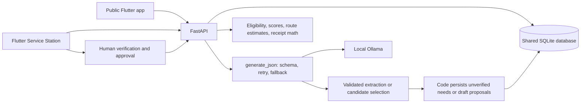

# Architecture

Rahat has one operational database and two clients: the public/mobile app in
[../frontend/README.md](../frontend/README.md) and the coordinator Service
Station in [../station/README.md](../station/README.md). AI is a backend
component, not a separate source of incident truth.



```text
Flutter: public/mobile app + separate Service Station
  | one server URL; JWT for protected operations
  | durable local SOS outbox; stable client_uuid; status receipt
  v
FastAPI (backend/app/main.py), REST API and compiled Flutter hosting
  |-- Auth: Argon2 passwords, expiring JWT, scoped roles
  |-- SOS: save first, UUID dedupe, status capability, background interpretation
  |-- Volunteers: self-registration, organizations/employees, verified skills
  |-- Needs: report extraction, quantities, verification and progress
  |-- Matching: skill/window/range/availability checks, ranked candidates
  |-- Assignments: proposed -> human approval -> volunteer outcome
  |-- Supplies: reservation -> dispatch -> delivery -> confirmed receipt
  |-- Intelligence: baseline/imports, exposure evidence, bottlenecks, recovery
  |-- Command Station: incident state machine, dispatch waves, resource ledger,
  |--     road hazards, AI coordination, WebSocket stream, coverage analytics
  |-- Platform adapter: signed RMP ingest + explicitly simulated radio bridge
  v
SQLAlchemy / SQLite + Alembic migration
  shared needs, raw_reports, sos_events, volunteers, assignments, stock,
  ai_proposals, ai_call_log and hash-linked audit_log
  ^ command station reads/writes the same tables; no separate incident store
  ^
  | validated schemas, draft choices, explicit source='ai' or 'fallback'
Local ai/ package -> Ollama qwen2.5:3b
```

## SOS

The Flutter app writes to preferences before posting `/sos`. A network timeout
retains the UUID; retries cannot create a second event. Success means database
receipt, not dispatch. `/sos/{id}/status` requires its opaque receipt token and
returns no original message or coordinates. Full `/sos` data requires coordinator
authentication. The command workspace polls every 15 seconds; user status polls
every 20 seconds while that screen is open. Background AI links nearby needs
only when sufficient incident/location records exist. Missing coordinates are
not invented and can require human follow-up.

Signed packets received at `/api/v1/ingest/packet` use the inherited codec's
cryptographic verification, then the same `sos_events` store. A valid signature
does not mean its sender identity has been vetted. The Mesh Lab queues packets
while its simulated bridge is disconnected and feeds the same ingest service
on reconnection. Its coordinates and data are explicitly synthetic.

## Volunteer allocation

An individual creates an account/profile and adds skills and availability.
An organization administrator can register employee accounts and multiple
skills only inside their organization. Matching requires verified skills,
location, availability window, travel range and a feasible estimated route.
Code ranks candidates. AI chooses only from validated candidates. A proposed
assignment is not active until human approval, which revalidates feasibility.
Field outcomes, not dispatch, complete task needs. Supply needs complete only
from confirmed received quantities.

## Command Station

The Command Station (`backend/app/routers/command_station.py`) is a
coordination layer over the same shared backend used by the rest of the app,
not a separate store of incident data. All endpoints live under `/api/v1`.

It provides:

- **Incident state machine:** received → acknowledged → verified →
  awaiting_dispatch → assigned → responding → on_scene → resolved, with
  cancelled reachable from any non-terminal state. Every transition is
  recorded in the hash-linked `audit_log`.
- **Volunteer dispatch engine:** eligibility checks, timed invitation waves,
  confirmation, ETA comparison, assignment reservation and automatic fallback
  when a volunteer declines or does not confirm.
- **Resource ledger:** requested quantities, pledges (allocations), dispatches,
  receipts, remaining needs, manual reconciliation and duplicate warnings.
- **Map and routing:** road hazards with freshness labels, verification,
  route-change notifications and alternative route consideration.
- **AI coordination:** model recommends assignments/allocations using real
  database state; deterministic backend logic enforces capacity, permissions,
  safety and assignments. Results are labelled `source=ai` or `source=fallback`.
- **Real-time stream:** WebSocket at `/api/v1/ws/stream` broadcasts incident
  state changes, dispatch waves, assignment confirmations and road hazard
  verifications to connected command-station operators.
- **Coverage analytics:** open needs by location, volunteer availability,
  unserved gaps and reassignment suggestions.

The Command Station never invents road closures, never assumes SOS delivery,
and never confirms receipts without evidence. Critical alerts still escalate
if the model or network is unavailable.

## AI boundaries

`ai/client.py::generate_json` centralizes schema validation, one retry, per-event-loop
single-flight inference and local call logging. No closed runtime AI providers.
Reports, skill mapping, chooser decisions and coordination output have concrete
consumers; see [../AI_USAGE.md](../AI_USAGE.md). Fallbacks are deliberately basic
and labelled. The configured Ollama endpoint defaults to localhost.

### Report to Assignment

1. `create_report` saves a raw report and calls `parse_report` for categories,
  urgency, quantities, skills and missing-information questions.
2. Code resolves an existing incident and location. Only with usable context
  does it create unverified needs. Questions are stored; there is no automatic
  two-way follow-up conversation.
3. `resolve_need_skills` invokes the skill mapper only if the need has no
  required skills. Code checks verified skills, availability and estimated
  routes, then calculates a fixed candidate score.
4. `propose_ai_assignment` sends the top three eligible candidates to the
  chooser. Its selected ID must belong to that list. Code creates a draft.
5. A manager approves after feasibility is rechecked. The assigned volunteer
  accepts, reports progress, and records an outcome. Supply fulfillment still
  requires confirmed receipts rather than an assignment completion alone.

### Coordination Cycle

`run_coordination_cycle` gathers open needs and builds assignment and allocation
candidates. Candidate context includes urgency, remaining quantity, verified
skills, score breakdowns, estimated travel time and stock availability. Code
limits the input to twenty candidates and the selection to five actions.
The model selects candidate IDs and supplies rationale/confidence; code checks
those IDs and creates the drafts. Reusing a batch UUID returns prior proposals.

This is **one structured selection**, not an iterative tool loop. The full
situation summary, hazards digest and previous outcomes are not included in
the prompt. There is no general tool registry, confidence-based auto-approval,
or feedback-driven model update. The periodic scheduler scans for bottlenecks;
it is not a scheduled AI coordination loop.

### Explanation Versus Action

Exposure scores and candidate rankings are computed by code. AI can recommend
attention order among supplied locations and explain evidence. Duplicate
judgments enrich flags without merging reports. Bottleneck explanations and
recovery narratives are returned to users; their text is not an instruction
executor. These distinctions are important when presenting the system's AI use.

## Data/import boundaries

External adapters have timeouts and saved snapshots. Their availability, source
licensing, completeness and data recency are separate from algorithm correctness.
Synthetic baselines are never described as a verified government feed.
Routing is a geometry-based estimate, not navigation on a road network.
See [DATA_SOURCES.md](DATA_SOURCES.md) for attribution and snapshot requirements.

## Failure and Trust Boundaries

- A saved SOS and its receipt precede background interpretation. A model
  outage does not undo that receipt; interpretation and notifications may
  still be delayed or fail separately.
- Reports use a synchronous parsing path, so slow model attempts can delay
  the report response. It is not the same save-first contract as SOS intake.
- Schema and candidate-ID validation constrain output shape and choices,
  not factual accuracy. Human review is still required.
- Operational outcomes change need/volunteer status and ledger records. They
  do not update matching weights, dedupe thresholds or model parameters.
- Audit entries and AI-call records support inspection. Their presence is
  not a certification of safety, privacy or production readiness.
